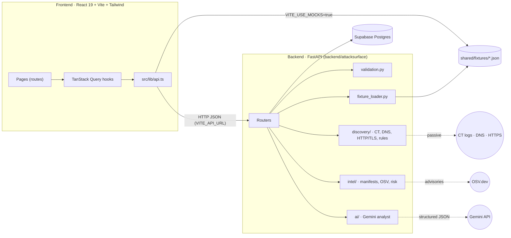
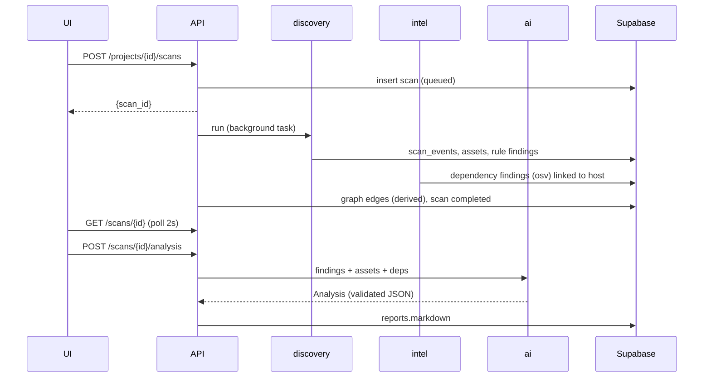
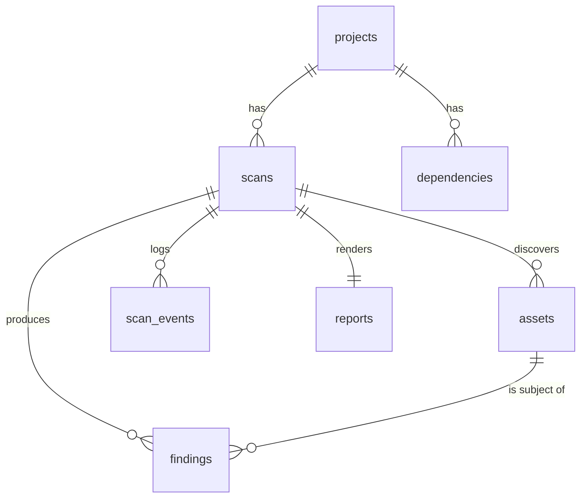

# AttackSurface — Architecture

**Last updated:** 2026-11-21 · Related: [PRD.md](PRD.md) · [AI-AGENT.md](AI-AGENT.md) · [DESIGN.md](DESIGN.md) · [shared/api-contract.md](shared/api-contract.md)

## 1. Overview

A React single-page app talks to a FastAPI backend over a typed JSON contract. The backend persists to Supabase (Postgres) and will run three pipeline stages: passive discovery, dependency intel, and AI analysis. Every endpoint has a matching JSON fixture in `shared/fixtures/`, so the frontend can run entirely in mock mode and the backend can stub any stage that isn't built yet.



## 2. Repository layout

```text
.
├── src/                      Frontend (Vite + React + TypeScript)
│   ├── pages/                One component per route
│   ├── layouts/AppLayout.tsx Project shell: band, header, folder-tab nav, sheet
│   ├── components/           Shared UI (Stamp, ClassificationBand, DataTable, SeverityBadge, …)
│   ├── hooks/                One TanStack Query hook per endpoint
│   ├── lib/                  api client, types, severity, markdownBlocks, utils, constants
│   ├── mocks/fixtures.ts     Imports shared/fixtures for mock mode
│   └── styles/               globals.css (design tokens), print.css
├── backend/attacksurface/    FastAPI app (uv project, Python ≥ 3.12)
│   ├── main.py               App, CORS, router registration, /health
│   ├── config.py             Settings from environment
│   ├── routers/              projects, scans, dependencies, analysis, reports, auth
│   ├── database/client.py    Supabase client (service key)
│   ├── jwt.py                HS256 JWT helpers + JWTBearer dependency (not yet wired)
│   ├── schemas.py            Pydantic models, which mirror src/lib/types.ts
│   ├── validation.py         Root-domain validation
│   ├── fixture_loader.py     Reads shared/fixtures
│   └── discovery/ intel/ ai/ Pipeline stages (empty packages today)
├── shared/
│   ├── api-contract.md       Source of truth for endpoints and types
│   └── fixtures/             One JSON (or .md) per endpoint response
├── supabase/schema.sql       Database schema
├── scripts/check-markdown.ts Self-check for the report parser
├── public/fonts/             Self-hosted Archivo, Public Sans, Courier Prime
└── .github/workflows/ci.yml  Frontend + backend CI
```

## 3. Frontend

**Stack:** React 19, React Router 7, TanStack Query 5, Tailwind 3, @xyflow/react (graph), react-dropzone (uploads), lucide-react (icons).

### Routes (`src/router.tsx`)

| Path | Page | Data |
|---|---|---|
| `/` | LandingPage | Static, built from `shared/fixtures` at build time |
| `/projects/new` | NewProjectPage | `POST /projects` |
| `/projects/:id` | DashboardPage | project, scan, assets, findings, dependencies, analysis |
| `/projects/:id/scans/:scanId` | ScanProgressPage | `GET /scans/:id`, polling every 2s until `completed` |
| `/projects/:id/assets` | AssetsPage | assets + findings |
| `/projects/:id/findings` | FindingsPage | findings + assets + analysis |
| `/projects/:id/dependencies` | DependenciesPage | list + upload |
| `/projects/:id/graph` | GraphPage | graph |
| `/projects/:id/report` | ReportPage | `report.md`, parsed by `lib/markdownBlocks.ts` |
| `*` | NotFoundPage | — |

### Data flow

`page → hook (useX) → api.x() → fetch | fixture`. `src/lib/api.ts` checks `import.meta.env.VITE_USE_MOCKS === "true"`. In mock mode it returns the fixture after a short artificial delay; otherwise it calls `VITE_API_URL` (default `http://localhost:8000`). Mock mode is **off unless the variable is exactly `"true"`**, so copy `.env.example` to `.env` for the demo.

Note: app pages currently read the demo scan via `DEMO_SCAN_ID` (`src/lib/constants.ts`) rather than the project's latest scan. Replace this once scans persist.

### Design system

All colors are CSS variables in `src/styles/globals.css` (60/30/10: Abyss Navy, Camel Suede, Electric Kiwi). `tailwind.config.js` reads only those variables. Rules and component specs live in [DESIGN.md](DESIGN.md).

## 4. Backend

**Stack:** FastAPI, Pydantic 2, supabase-py, PyJWT, uv. Entry point: `attacksurface:app` (`uv run fastapi dev`).

### API surface

| Method | Path | Router | Backing today |
|---|---|---|---|
| GET | `/health` | main | live |
| POST | `/projects` | projects | **Supabase** (validates authorization + domain) |
| GET | `/projects` | projects | **Supabase** |
| GET | `/projects/{id}` | projects | **Supabase** |
| POST | `/projects/{id}/scans` | scans | fixture |
| GET | `/scans/{id}` | scans | fixture (echoes id) |
| GET | `/scans/{id}/assets` | scans | fixture |
| GET | `/scans/{id}/findings` | scans | fixture |
| POST | `/projects/{id}/dependencies` | dependencies | fixture (reads the upload, ignores it) |
| GET | `/projects/{id}/dependencies` | dependencies | fixture |
| GET | `/scans/{id}/graph` | analysis | fixture |
| POST | `/scans/{id}/analysis` | analysis | fixture |
| GET | `/scans/{id}/report.md` | reports | fixture (text/markdown) |
| GET | `/sign_up`, `/sign_in`, `/sign_out` | auth | WIP placeholders |

### Scan lifecycle (target design)



Run stages as FastAPI background tasks (or a worker) so `POST /scans` returns immediately. Each stage appends `scan_events` so the UI log stays truthful.

## 5. Data model (`supabase/schema.sql`)



- All IDs are UUIDs (`gen_random_uuid()`), with `ON DELETE CASCADE` from parents.
- Enum-like `CHECK` constraints cover scan `status`, asset `environment`/`status`, finding `severity`/`source`, and event `level`.
- `dependencies.advisories` is `jsonb` and holds the advisory list.
- **Gap:** `dependencies` has no `asset_id`, so the host ↔ package correlation can't be stored. Add a nullable `asset_id uuid references assets(id)`.
- `graph` and `analysis` have no tables; derive the graph from assets, findings and fixes, and cache the analysis in `reports` or a new `analyses` table.

## 6. The shared contract

The API contract is defined in four places that must change together:

1. `shared/api-contract.md` (the documented source of truth)
2. `backend/attacksurface/schemas.py` (Pydantic)
3. `src/lib/types.ts` (TypeScript)
4. `shared/fixtures/*.json` (example payloads for both mock mode and stubs)

## 7. Configuration

| Variable | Used by | Notes |
|---|---|---|
| `VITE_API_URL` | frontend | Default `http://localhost:8000` |
| `VITE_USE_MOCKS` | frontend | Must be `"true"` to use fixtures |
| `SUPABASE_URL` | backend | **Required at import** |
| `SUPABASE_SERVICE_KEY` | backend | **Required at import**. Service role: server-side only |
| `JWT_SECRET` | backend | **Required at import**. Missing from `.env.example` |
| `GEMINI_API_KEY`, `GEMINI_MODEL` | backend | For the AI analyst (default `gemini-2.0-flash`) |
| `SCAN_RATE_LIMIT_PER_MIN` | backend | Default 30. Declared but not yet enforced |

CORS allows `http://localhost:5173` only; add the deployed frontend origin for production.

## 8. Build, CI, deploy

- **Local:** `make install`, then `make dev` (both servers), or `make frontend` / `make backend`.
- **CI** (`.github/workflows/ci.yml`): the frontend job runs `npm ci`, lint, typecheck and build. The backend job runs `uv sync --locked`, ruff and pytest.
- **Frontend deploy:** Vercel; `vercel.json` rewrites every path to `index.html` for SPA routing.
- **Backend deploy:** not yet defined.

## 9. Security model

- **Passive only:** discovery may read CT logs, DNS, and one HTTP(S) request per host for headers and certificates. No port scans, brute force, or payloads.
- **Authorization gate:** `POST /projects` rejects `authorization_confirmed=false`, and `validation.py` rejects anything that isn't a registrable domain.
- **Secrets:** the Supabase service key bypasses row-level security, so it lives only on the server. Nothing secret goes in `VITE_*`.
- **Prompt safety:** collected data (headers, banners) is untrusted input to the AI analyst; see [AI-AGENT.md](AI-AGENT.md).

## 10. Known issues

| Issue | Where | Impact |
|---|---|---|
| Config raises `KeyError` at import without Supabase/JWT env | `config.py` | Backend tests and CI fail without secrets; `.env.example` lacks `JWT_SECRET` |
| `GET /projects/{id}` indexes `resp.data[0]` without a check | `routers/projects.py` | An unknown id returns 500 instead of 404 |
| Auth routes are GET with hardcoded credentials; `SignInModel`/`SignUpModel` unused | `routers/auth.py` | Placeholder; credentials must move to a POST body |
| `decode_jwt` uses a bare `except` | `jwt.py` | Hides errors; `JWTBearer` isn't applied to any route |
| Scans, assets, findings, deps, analysis, graph and report are fixtures | routers | Live mode shows demo data for every project |
| No manifest ↔ host link | schema + upload | The correlation claim isn't backed by data yet |
| App pages use `DEMO_SCAN_ID` | frontend | Real projects show the demo scan |
| `backend/README.md` and the root README reference `backend/app/` and pip | docs | Paths are actually `backend/attacksurface/` with uv |
