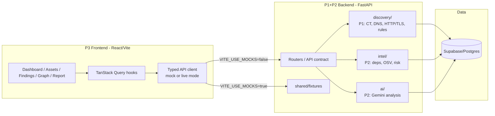

# AttackSurface

AttackSurface is an AI-powered external attack surface intelligence platform that turns publicly exposed assets and dependency vulnerabilities into prioritized, actionable security insights.

> Hackathon scaffold: discovery/intel/AI modules are stubbed. The API and frontend work end-to-end using realistic fixtures.

## Architecture



## Repo Structure

```text
.
├── src/                    # Frontend app (P3) - Vite + React + TypeScript
│   ├── components/         # Reusable UI components
│   ├── hooks/              # TanStack Query hooks per endpoint
│   ├── layouts/            # AppLayout (sidebar + top bar)
│   ├── lib/                # types, api client, query client, utils
│   ├── pages/              # Route pages
│   └── styles/             # globals.css, print.css
├── backend/                # FastAPI app (P1 + P2)
│   ├── app/
│   │   ├── routers/        # projects, scans, dependencies, analysis, reports
│   │   ├── discovery/      # P1: ct.py, dns.py, http_meta.py, rules.py
│   │   ├── intel/          # P2: deps.py, osv.py, risk.py
│   │   ├── ai/             # P2: gemini.py
│   │   ├── schemas.py      # Pydantic models matching API contract
│   │   └── main.py
│   └── tests/
├── shared/
│   ├── fixtures/           # Realistic JSON fixtures per endpoint
│   └── api-contract.md
├── supabase/
│   └── schema.sql
├── .github/workflows/ci.yml
├── .env.example
├── Makefile
└── vercel.json
```

## Setup

### Prerequisites
- Node.js 20+
- Python 3.11+

### 1) Install dependencies

```bash
# Frontend (repo root)
npm install

# Backend
python -m pip install -r backend/requirements.txt
```

### 2) Configure environment

```bash
cp .env.example .env
```

Default mock mode works without backend secrets.

### 3) Run

```bash
# Terminal 1 - backend
make backend
# or: cd backend && python -m uvicorn app.main:app --reload --port 8000

# Terminal 2 - frontend
make frontend
# or: npm run dev
```

- Frontend: http://localhost:5173
- Backend: http://localhost:8000
- API docs: http://localhost:8000/docs

## Mock Mode

The frontend has a typed API client in `src/lib/api.ts`.

- `VITE_USE_MOCKS=true` (default): returns fixture data from `shared/fixtures` with a small artificial delay. Every page works without the backend.
- `VITE_USE_MOCKS=false`: calls `VITE_API_URL` (default `http://localhost:8000`). FastAPI stubs return the same fixture data, so the UI behaves the same end-to-end.

## Ownership

| Area | Owner | Path |
|---|---|---|
| Discovery backend | P1 | `backend/app/discovery/`, scan/discovery router integration |
| Intelligence/AI backend | P2 | `backend/app/intel/`, `backend/app/ai/`, analysis/dependency logic |
| Frontend | P3 | `src/`, frontend config, UI/UX, mock/live API client |
| Shared contract | All | `shared/api-contract.md`, `shared/fixtures/`, `backend/app/schemas.py`, `src/lib/types.ts` |

## API Contract

See [`shared/api-contract.md`](./shared/api-contract.md). Backend stubs implement the contract and return fixtures on day one.

## Safety and Scope Rules

- **Authorized targets only**. Project creation requires `authorization_confirmed=true`; the API rejects unauthorized requests.
- **Passive discovery only**. CT logs, DNS, and HTTP/TLS metadata. No brute-forcing, port scanning, or exploitation.
- **Domain validation**. `root_domain` must be a registrable domain; IPs, wildcards, schemes, and paths are rejected.
- **Potential exposure, not proof**. Graph and findings represent potential exposure paths and should be validated before action.
- **Secrets**. Never commit real keys. Never put backend secrets in `VITE_` variables (exposed to browser).

## Commands

```bash
npm run dev        # frontend dev server
npm run build      # frontend production build
npm run typecheck  # tsc --noEmit
npm run lint       # eslint
cd backend && python -m pytest -q
cd backend && python -m ruff check .
```
